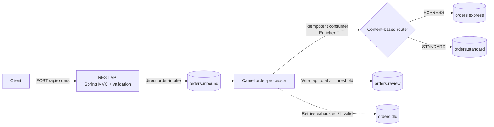

# order-integration-hub

[](https://github.com/Sunil994923/order-integration-hub/actions/workflows/ci.yml)


An event-driven order integration service. It accepts orders over REST, publishes them to Kafka, and uses Apache Camel to enrich, de-duplicate and route each order to the right downstream topic. Invalid or failing messages go to a dead-letter topic instead of being lost.

It is a small, complete example of the enterprise integration patterns used in real order, payment and fulfilment systems.

## Architecture



| Pattern | Where | Why |
|---|---|---|
| Message channel | Kafka topics `orders.*` | Decouples the API from downstream processing |
| Idempotent consumer | `order-processor` route | Kafka delivers at-least-once, so duplicates are dropped by order id |
| Content enricher | `OrderEnricher` | Calculates the total and the high-value flag once, centrally |
| Content-based router | `choice()` on shipping method | Each fulfilment channel gets only its own orders |
| Wire tap | `high-value-review-tap` route | Review gets a copy without slowing down fulfilment |
| Dead letter channel | Error handler | Failures are kept with the original payload for replay |

**Error handling**
- Transient errors (for example the broker is unavailable) are retried with exponential back-off: 3 attempts, starting at 1 s, configurable.
- Permanent errors (malformed JSON or an invalid order) are not retried. They go straight to `orders.dlq` with an `orderhub-error` header.
- Messages are keyed by order id, so every event for an order lands on the same partition and keeps its order.

## Tech stack

Java 21 · Spring Boot 4.1 · Apache Camel 4.23 (Kafka, Jackson) · Apache Kafka · JUnit 5, Camel Test, Spring Kafka embedded broker · Docker Compose · GitHub Actions

## Run it locally

**Prerequisites:** JDK 21. You also need Docker, or any Kafka broker reachable at `localhost:9092`.

```bash
# 1. Start Kafka
docker compose up -d kafka

# 2. Start the service
./mvnw spring-boot:run          # Windows: mvnw.cmd spring-boot:run

# 3. Submit orders
curl -i -X POST localhost:8080/api/orders -H "Content-Type: application/json" -d @samples/express-high-value-order.json
curl -i -X POST localhost:8080/api/orders -H "Content-Type: application/json" -d @samples/standard-order.json
curl -i -X POST localhost:8080/api/orders -H "Content-Type: application/json" -d @samples/invalid-order.json   # 400 Problem Details
```

Or run the whole stack in containers with `docker compose up --build`.

**Watch the output topics:**

```bash
docker compose exec kafka /opt/kafka/bin/kafka-console-consumer.sh \
  --bootstrap-server localhost:9092 --topic orders.express --from-beginning --property print.key=true
```

**Health and routes:** `GET /actuator/health` and `GET /actuator/camelroutes`

### Example

Request:

```json
{ "customerId": "customer-42", "shippingMethod": "EXPRESS",
  "items": [ { "sku": "LAPTOP-15", "quantity": 1, "unitPrice": 1499.00 } ] }
```

Response `202 Accepted`:

```json
{ "orderId": "4abf9c11-875c-40ae-b1d7-eac809802b0d", "status": "ACCEPTED" }
```

The message on `orders.express` (and a copy on `orders.review`, because the total is at least 1000):

```json
{ "orderId": "4abf9c11-...", "receivedAt": "2026-10-25T05:31:10.123Z", "customerId": "customer-42",
  "items": [ { "sku": "LAPTOP-15", "quantity": 1, "unitPrice": 1499.00 } ],
  "shippingMethod": "EXPRESS", "totalAmount": 1499.00, "highValue": true }
```

Kafka headers: `orderhub-order-id`, `orderhub-shipping-method`, `orderhub-high-value`.

## Configuration

| Variable | Default | Description |
|---|---|---|
| `KAFKA_BROKERS` | `localhost:9092` | Kafka bootstrap servers |
| `ORDERHUB_HIGH_VALUE_THRESHOLD` | `1000.00` | Totals at or above this go to `orders.review` |
| `SERVER_PORT` | `8080` | HTTP port |

All endpoint URIs live under `orderhub.endpoints.*` in [application.yml](src/main/resources/application.yml). The tests replace them with in-memory endpoints, so the route logic can be tested without a broker.

## Tests

```bash
./mvnw verify
```

| Test | Type | Covers |
|---|---|---|
| `OrderEnricherTest` | Unit | Totals, rounding, high-value threshold, invalid lines |
| `OrderRoutesTest` | Camel route | Routing, wire tap, duplicate suppression, dead-letter for invalid and malformed messages |
| `OrderControllerTest` | API | 202 response and publishing; 400 Problem Details for invalid payloads |
| `OrderFlowIT` | Integration | Full flow through a real (embedded) Kafka broker |

## Project structure

```
src/main/java/io/github/sunil994923/orderhub
├── api/        REST controller
├── model/      Request, event and response records
├── route/      Camel routes (integration flow)
└── service/    Enrichment and submission logic
samples/        Example payloads
```

## Possible next steps

- Persistent idempotent repository (JDBC or Kafka-backed) so de-duplication survives restarts
- Schema Registry with Avro for the order event contract
- An order-status endpoint backed by a state store
- Metrics for routed, rejected and dead-lettered messages (Micrometer)

## License

[MIT](LICENSE)
